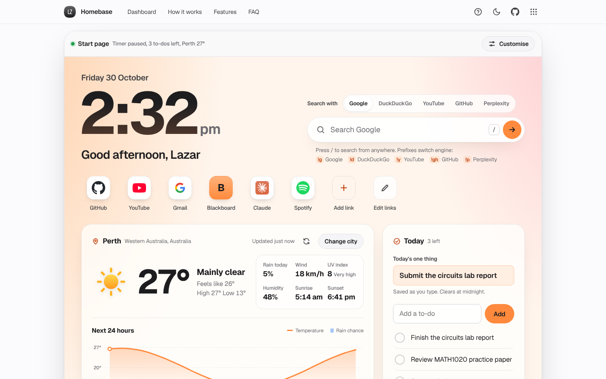

# Homebase

A calmer place to start every tab: a browser start page with a big clock, local weather and a 24-hour chart, quick links, today's to-dos, a focus timer and notes.

[](https://lz-homebase.pages.dev/)

Mirror: https://lazarzec18.github.io/homebase/



## Features

**Clock**
- Large clock with the date and a greeting that uses your name ("Good afternoon, Lazar").
- 12 or 24-hour time.

**Weather** (Open-Meteo, no key needed)
- Current temperature, feels-like, condition, high and low, rain chance, wind, UV index, humidity, sunrise and sunset.
- Hand-drawn SVG icons for every WMO weather code, with day and night versions.
- A 24-hour chart: temperature line over rain-chance bars, with a tooltip on hover, tap or arrow keys.
- A 7-day row with highs, lows, rain chance and a range bar for each day.
- City search with a result picker, or "Use my location". Defaults to Perth, WA.
- Cached for 30 minutes, with "Updated 5 min ago", a refresh button, and clear offline and error states.

**Search**
- Google, DuckDuckGo, YouTube, GitHub and Perplexity.
- Press `/` from anywhere to start typing.
- Prefixes switch engine for one search: `!g`, `!d`, `!y`, `!gh`, `!p` (for example `!y lofi beats`).

**Quick links**
- Site icons from Google's favicon service, with a letter tile when a site has none.
- Add, rename and remove with undo. Drag to reorder, or use the arrow buttons.

**Today, focus and notes**
- Today's one thing, plus to-dos you can tick, edit, delete and drag into order. Finished items fold into a Done list.
- Focus timer with 25/5, 50/10 and 15/3 presets, a progress ring, a chime at the end and a session count.
- An autosaving scratchpad with a word count.

**Customise**
- Name, °C or °F, 12 or 24-hour clock.
- Turn each widget on or off and change their order.
- Six backgrounds, including three slowly drifting mesh tints that stay still when reduced motion is on.
- Export everything to a JSON file and import it on another computer.

## Set it as your start page

Copy the address first: `https://lz-homebase.pages.dev/`

- **Chrome (desktop):** Settings, then On startup, then "Open a specific page or set of pages". Add the address. For a home button, go to Settings, then Appearance, turn on "Show home button" and enter the address.
- **Safari (Mac):** Safari, then Settings, then General. Paste the address into Homepage, then set "New windows open with" and "New tabs open with" to Homepage.
- **Edge:** Settings, then "Start, home, and new tabs". Under "When Edge starts", choose "Open these pages" and add the address. Turn on "Show home button" and set it to the same address.
- **Chrome on Android:** Menu, then Settings, then Homepage. Turn it on and choose "Enter custom web address".

Chrome and Edge only let extensions replace the new tab page itself, so use the startup page and home button instead.

## How it works

The weather card makes one Open-Meteo request with current, hourly and daily variables and `timezone=auto`, so every time in the response is already local to the chosen city. Homebase finds the current hour in the hourly series, takes the next 24 hours and draws them as an SVG: a monotone cubic curve (Fritsch–Carlson), so the line never overshoots between hours, over rain-probability bars. Temperatures are always fetched in Celsius and converted on the client, so switching units never needs a new request. Responses are cached in local storage for 30 minutes per location.

Drag-to-reorder for links, to-dos and widgets uses one small pointer-events helper, so it works with a mouse, a finger or a pen. Every list also has keyboard controls. The focus timer stores an end timestamp instead of counting ticks, so it stays accurate in a background tab and survives a reload.

All state lives in namespaced local storage through the shared Zec Labs kit, and the export file is the same data as JSON.

## Tech

- Vanilla HTML, CSS and JavaScript. No framework, no build step.
- Zec Labs kit (`zl.css`, `zl.js`) for the nav, toasts, dialogs, tour and storage.
- Open-Meteo forecast and geocoding APIs.
- Geist from Google Fonts.
- Playwright (Python) for end-to-end tests.

## Run locally

```bash
python3 -m http.server
```

Then open http://localhost:8000.

## Project structure

| File | What it does |
| --- | --- |
| `index.html` | Dashboard, About, How it works, Features, FAQ and dialogs |
| `styles.css` | App styles on top of the kit tokens |
| `core.js` | Settings, status line, sortable helper, shared utilities |
| `weather.js` | Forecast, icons, 24-hour chart, 7-day row, city search |
| `widgets.js` | Quick links, Today, focus timer, notes |
| `app.js` | Clock, search, layout, Customise, backup, tour |
| `zl.css`, `zl.js` | Shared Zec Labs kit (unchanged) |
| `_headers` | Cloudflare Pages security and cache headers |

## Testing

The Playwright suite mocks Open-Meteo forecast and geocoding, the favicon service and every search engine with `page.route`, and controls time with Playwright's clock, so results are deterministic. It covers:

- The guided tour: every step's target exists, and it completes and is remembered.
- Clock, greeting with a name, and 12/24-hour time.
- Weather values, the hourly chart (bars, axis labels, tooltip, keyboard), the 7-day row, °F conversion, the 30-minute cache, refresh, city search and its persistence.
- Offline and service-error states, and recovery with "Try again".
- Search URLs for all five engines, every bang prefix, the empty-search hint and the `/` shortcut.
- Links: add with validation, edit, move, drag, remove with undo, and persistence.
- To-dos: add, check into Done, edit, delete with undo, drag and keyboard reorder, and persistence. Today's one thing and notes persist.
- The focus timer counting down, pausing and completing with a chime.
- Widget toggles, order and background persisting; export and import.
- No horizontal overflow at 390px, 16px inputs, tap target sizes, dark mode, and no console errors.

---

Part of Zec Labs, a set of small, polished web apps by [Lazar Zec](https://github.com/LAZARZEC18). See them all at https://lazarzec.pages.dev/
